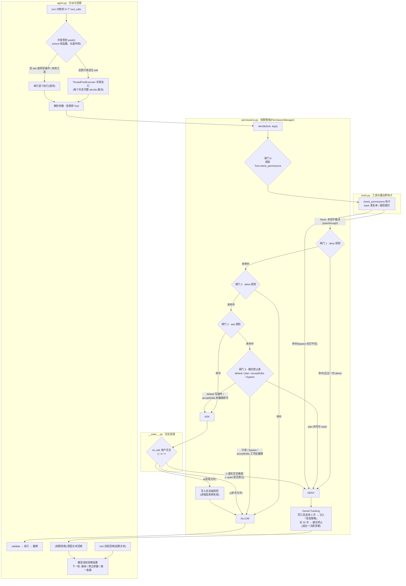

# 迭代 3：权限管线 Permission —— 三道闸门、四态裁决与死循环防护

> 代码：`mini_agent/permissions.py`（权限核心）｜`mini_agent/tools.py`（闸门 0 钩子）｜`mini_agent/agent.py`（裁决集成）｜`mini_agent/__main__.py`（CLI 模式与交互）
> 测试：`tests/test_permissions.py`（29 个新单测）
> 参考资料：[claude-code-best/claude-code](https://github.com/claude-code-best/claude-code) `docs/safety/permission-model.mdx`（Allow/Ask/Deny 体系 + 8 层规则来源 + Denial Tracking）

## 0. 这一迭代要解决什么问题

迭代 2 的 agent 是个「愣头青」：`bash("rm -rf build")` 和 `bash("git status")`
被同等对待——黑名单只有一条子串匹配，文件写入从不询问，`--quiet` 跑批时
更是无差别放行。真实世界的编码 Agent 必须回答一个问题：

> **模型想执行一个有副作用的操作，凭什么放行？**

Claude Code 的答案是三层裁决体系（Allow / Ask / Deny）+ 多层规则来源 +
死循环防护。本轮把这套管线完整搬进 mini-agent。

## 1. 环境（无新增依赖）

零新增依赖（fnmatch/json 均为标准库）。

```bash
cd /Users/nian/CatPaw/agent-mini-harness
.venv/bin/pip install -r requirements.txt   # 无变化，可跳过
```

## 2. 代码结构拆解

```
mini_agent/
├── permissions.py   # ★ 本轮核心：Behavior 枚举 + PermissionManager + 规则匹配 + settings 加载
├── tools.py         # Tool.check_permissions 钩子（闸门 0：黑名单/路径围栏前移）
├── agent.py         # _execute_tool_call 里插入 decide()；并发批次 ask 预检串行化
└── __main__.py      # --permission-mode / --yes / 终端 y/a/n 交互 / settings 自动加载
tests/
└── test_permissions.py   # 29 个新单测
```

### 2.1 四态裁决（Behavior）

| 行为 | 含义 | 触发后 |
|------|------|--------|
| `ALLOW` | 放行 | 执行工具 |
| `ASK` | 需确认 | 调 on_ask 回调（y/a/n）→ yes 放行 / always 写入会话规则 / no 拒绝 |
| `DENY` | 拒绝 | `[权限拒绝] 原因` 作为观察回填，模型读后改变策略 |

第四态是 `check_permissions` 钩子返回 `None`——「本层不裁决，交给通用闸门」，
对应 CC PermissionResult 的 `passthrough` 语义。

### 2.2 三道闸门（顺序就是语义）

```python
def check(self, tool, arguments):      # 纯函数，可安全并发调用
    # 闸门 0：工具自带硬边界（黑名单/路径围栏）→ deny 或 None
    # 闸门 1：deny 规则（最高优先级——deny 永远压过 allow）
    # 闸门 2：allow 规则 → ask 规则
    # 闸门 3：默认行为（按 permission_mode）
```

三个关键设计：

- **硬边界优先于一切**：bash 黑名单和路径围栏从 handler **前移**到闸门 0
  （`_bash_permission_check` / `_path_fence_check`）。连 `bypass` 模式都拦不住黑名单
  ——系统边界不随用户信任级别浮动。handler 里的 `safe_path` 保留为纵深防御。
- **deny > allow**：规则匹配顺序先 deny 再 allow，一条 deny 能压过一百条 allow
  （安全默认：宁可多问，不可错放）。
- **check() 与 decide() 分离**：`check()` 纯函数无副作用（并发批次预检用 `peek()`）；
  `decide()` 才处理交互与拒绝记录——交互回调只能串行调用。

完整裁决流程图（覆盖 2.2～2.8 的全链路，从 turn 收到 tool_calls 到观察回填）：



图的读法要点：**菱形是闸门（判定），矩形是动作；虚线框 = 源码模块归属**——
`agent.py` 负责分派与回填（循环骨架），`permissions.py` 拥有三道闸门、四态
裁决与 Denial Tracking，`tools.py` 提供闸门 0 的硬边界钩子（黑名单/围栏
定义在工具侧，由权限管线调用），`__main__.py` 只贡献 on_ask 交互回调。
任何一条 deny 路径都会走到 Denial Tracking → 拒绝文本回填。注意三个
「安全默认」：黑名单在 bypass 下仍拦截、deny 规则永远压过 allow、
无交互通道时 ask 降级为拒绝（宁可错杀，不可错放）。

### 2.3 规则匹配三维度（对应 CC toolMatchesRule）

```python
PermissionRule(tool="read_file", behavior=ALLOW)                  # 整工具
PermissionRule(tool="bash", behavior=ALLOW, content="git *")      # 命令前缀
PermissionRule(tool="write_file", behavior=ALLOW, content="src/**")  # 路径 glob
```

一个开发中实测踩到的坑：`git *` 的前缀匹配若把尾随空格剥掉（`rstrip()`），
`github-cli` 也会误命中——**前缀必须保留 `git ` 带空格**。单测
`test_bash_command_prefix_match` 专门锁住这个行为。

#### 2.3.1 PermissionRule 与 PermissionResult：判断依据与判断结论

**PermissionRule 是可反复使用的规则；PermissionResult 是针对本次工具调用产生的裁决。**
两者没有继承关系，规则也不会自动变成结果；由 `PermissionManager.check()` 在命中规则后构造结果。

| 对象 | 核心字段 | 职责 | 保存位置 |
|------|----------|------|----------|
| `PermissionRule` | `tool / behavior / content / source` | 声明哪些调用允许、拒绝或需要确认 | `PermissionManager.self.rules` 内存列表 |
| `PermissionResult` | `behavior / reason` | 告诉调用方本次操作该如何处理，以及原因 | 本次检查或裁决的返回值 |

规则来源与生命周期：

- 程序启动时，`load_settings_rules(Path.cwd())` 读取 `.mini-agent/settings.json`，通过 `parse_rule_entry()` 转成规则对象，传入 `PermissionManager`。
- 构造器用 `self.rules = list(rules or [])` 保存规则列表；没有配置文件时可以是空列表。
- 用户选择 `a`（总是允许）时，向该列表追加 `source="session"` 的 allow 规则，不写回配置文件；退出进程后失效。
- `source` 是来源标签，用于显示裁决理由，不直接决定匹配优先级。
- 用户给模型的自然语言任务不是授权规则；当前只有显式配置或确认交互等代码路径会添加规则。

**如果 settings.json 不存在，或者里面没有当前工具的规则，PermissionRule 从哪里来？**

答案是：**不一定会有 PermissionRule，也不需要先生成规则才能裁决。** `PermissionRule` 类只是规则对象的模板，
定义这个类、注册 Tool，都不会自动给每个工具创建一条规则。标准 CLI 在配置文件不存在时得到空列表；
文件存在但缺少当前工具的规则时，也不会自动补齐该工具的规则（其他通配规则仍可能匹配它）。

在没有匹配规则、且工具硬边界没有直接裁决的情况下，`check()` 调用 `_default_behavior(tool)`，
根据权限模式和 `tool.is_read_only` 等信息，**直接创建 PermissionResult，不创建 PermissionRule**。
工具硬边界同样可以直接返回 PermissionResult，完全不经过规则对象。

以没有 settings.json、default 模式调用 write_file 为例：

1. 启动：`load_settings_rules()` 返回 `[]`，管理器的 `self.rules=[]`。
2. 调用：写入路径通过工具硬边界检查，三次 `_match_rule()` 都找不到规则。
3. 默认裁决：`_default_behavior()` 返回 ASK 类型的 PermissionResult，此时规则列表仍为空。
4. 用户选 `y`：返回本次 ALLOW 的 PermissionResult，规则列表仍为空；下次写文件通常还要问。
5. 用户选 `a`：`decide()` 才执行 `PermissionRule(tool="write_file", behavior=Behavior.ALLOW, source="session")`，
   将新对象追加到 `self.rules`，并返回本次 ALLOW 的 PermissionResult。
6. 后续调用：`_match_rule(ALLOW, ...)` 可以找到这条会话规则，`check()` 据此生成新的 ALLOW 结果。

因此有两条不同路径：**没有规则 → 默认生成 Result；选择“总是允许” → 新建 Rule → 后续调用匹配 Rule 并生成 Result。**
如果由其他 Python 代码使用管理器，也可以显式构造 PermissionRule 并通过 `PermissionManager(rules=...)` 传入；
这是调用方创建规则，不是管理器自动生成内置规则。CLI 的 `--permission-mode` / `--yes` 在当前实现中设置的是模式，
也不会自动创建 PermissionRule。

#### 2.3.2 核心调用链：谁查规则，谁比较，谁生成结果？

入口是 `check(tool, arguments)`：`tool` 是本地工具对象，`arguments` 是模型给出的工具参数。
**`_match_rule` 属于 PermissionManager，不属于 Tool。** Tool 提供工具名与硬边界钩子，管理器负责查询规则。

```text
本次调用：tool.name="bash"，arguments={"command": "git status"}
    ↓
PermissionManager.check(tool, arguments)
    ├─ 先调用 tool.check_permissions(arguments)：硬边界有裁决就返回
    ├─ _match_rule(DENY, tool.name, arguments)
    ├─ _match_rule(ALLOW, tool.name, arguments)
    ├─ _match_rule(ASK, tool.name, arguments)
    └─ 都没有命中 → _default_behavior(tool)

每次 _match_rule 的内部：
    遍历 self.rules
    → 先筛选 rule.behavior 是否等于本次要查的行为
    → 再调用 _rule_matches(rule, tool_name, arguments)
    → 返回第一个匹配的 PermissionRule；找不到返回 None

check 拿到命中的规则 hit：
    → 构造 PermissionResult(对应行为, 包含 hit.source 和 hit.describe() 的原因)
```

这里有三个不同的返回类型，不能混淆：

| 函数 | 返回类型 | 回答的问题 |
|------|----------|------------|
| `_rule_matches()` | `bool` | 这一条规则适用于当前调用吗？ |
| `_match_rule()` | `PermissionRule \| None` | 这一类行为中，第一条适用的规则是哪条？ |
| `check()` | `PermissionResult` | 综合硬边界、规则和默认模式，本次裁决是什么？ |

`_match_rule()` 的等价展开如下（省略类型标注，便于阅读）：

```python
for rule in self.rules:
    if rule.behavior is not behavior:
        continue
    if _rule_matches(rule, tool_name, arguments):
        return rule
return None
```

**不是按列表顺序直接取第一条任意行为的规则。** `check()` 会先查完所有 deny 候选，再查 allow，最后查 ask。
因此规则行为优先级是 `DENY > ALLOW > ASK`；同一行为内部才按列表顺序取第一个匹配者。
这与多个 Hook 合并时的 `deny > ask > allow` 是不同的逻辑。

#### 2.3.3 _rule_matches：工具名与参数怎样对上规则？

单条规则按以下顺序匹配，完全由 Python 执行，不需要 LLM 判断：

1. **工具名**：`fnmatch.fnmatchcase(tool_name, rule.tool)`，支持大小写敏感的 glob；`tool="*"` 匹配全部工具。
2. **整工具规则**：工具名匹配且 `content is None`，直接返回 True，不检查具体命令或路径。
3. **bash 命令规则**：读取 `arguments["command"]`。`content` 以 `*` 结尾时，去掉最后一个星号后做 `startswith()`；否则做字符串全等比较。
4. **非 bash 的路径规则**：读取 `arguments["path"]`，路径缺失或为空则不匹配，否则使用 `fnmatch.fnmatch(path, content)`。

| 规则 | 当前调用 | 匹配结果 |
|------|----------|----------|
| `tool="bash", content=None` | bash 执行任意命令 | True，整工具授权 |
| `tool="bash", content="git status"` | `command="git status"` | True，精确匹配 |
| 同上 | `command="git diff"` | False，命令不同 |
| `tool="bash", content="git *"` | `command="git diff"` | True，前缀为 `git ` |
| 同上 | `command="github-cli"` | False，不以 `git ` 开头 |
| `tool="write_file", content="src/**"` | `path="src/main.py"` | True，路径模式匹配 |
| 同上 | `path="docs/note.md"` | False，路径不匹配 |

**bash 的 content 不是完整 glob，也不是 shell 安全分析器。** 当前实现只做末尾星号的前缀匹配或精确比较。
例如 `git *` 也可能匹配 `git status && 其他命令`，不能据此保证整个命令链只读。
文件路径使用的是 `fnmatch`，其 `*` 可以跨 `/`，不要直接套用其他 glob 库中 `*` 与 `**` 的目录层级规则。

#### 2.3.4 例子：PermissionRule 如何变成 PermissionResult？

**例 A：命中已有 allow 规则。** 内存中存在：

```python
PermissionRule(
    tool="bash",
    behavior=Behavior.ALLOW,
    content="git status",
    source="settings",
)
```

模型请求 `bash`，参数为 `{"command": "git status"}`：

1. 工具硬边界未拒绝。
2. `_match_rule(DENY, ...)` 找不到匹配规则，返回 None。
3. `_match_rule(ALLOW, ...)` 找到上面的规则，返回该规则对象。
4. `check()` 构造 `PermissionResult(Behavior.ALLOW, "命中 allow 规则[settings]: bash:git status")`。
5. 普通 `decide()` 路径直接返回允许结果，不调用 `on_ask`。

**例 B：allow 与 deny 同时匹配。** 即使存在 `tool="bash", content=None` 的整工具 allow，
只要另有一条匹配当前调用的 deny，`check()` 就会在查 deny 阶段返回 DENY，不再查 allow。
用户选择“总是允许”追加的规则也不能推翻 deny 或工具硬边界。

**例 C：没有规则命中。** `self.rules=[]`，模型请求 `bash` 执行 `wc -l mini_agent/agent.py`：

1. 三次 `_match_rule()` 都返回 None。
2. `_default_behavior()` 在 default 模式下看到 `bash.is_read_only=False`，返回 ASK。
3. 这里没有将 `wc` 分析为写命令，而是 bash 工具整体不能保证只读；源码理由中的“写操作需确认”是较粗的表述。
4. `decide()` 调用 `on_ask(tool.name, arguments, result.reason)` 等待用户选择。

| 用户选择 | 当前返回的 PermissionResult | 对规则列表的影响 |
|----------|-----------------------------|------------------|
| `y` | ALLOW，用户本次允许 | 不添加规则 |
| `a` | ALLOW，已写入会话级规则 | 追加当前工具的 allow 规则 |
| `n` | DENY，用户拒绝 | 不添加规则，更新拒绝计数 |
| 无交互回调 | DENY，默认拒绝 | 不添加规则，更新拒绝计数 |

选 `a` 后，新增的是 `PermissionRule(tool="bash", behavior=Behavior.ALLOW, source="session")`，
**没有 content 限制，所以授权整个 bash 工具，而不只是当前 wc 命令。** 下一次 bash 调用命中该规则后，
通常无需再询问；硬边界、deny 规则以及迭代 4 的 Hook 拦截仍然有效。

#### 2.3.5 check 与 decide 的边界

- `check()`：只得出 ALLOW / ASK / DENY，不询问用户，也不修改规则列表或拒绝计数。
- `peek()`：直接调用 `check()`，用于执行前预检。
- `decide()`：处理 `check()` 的结果；ASK 时调用回调，将用户答案变为最终 ALLOW / DENY，必要时追加会话规则。
- 模式默认表只在所有配置规则都未命中时使用，不是独立于规则的最高优先级安全边界。
- 迭代 4 起 Agent 还会通过 `_permission_with_hook()` 融合 PreToolUse 的意见；本节讲的是权限管理器内部的规则匹配链，不代替 Hook 融合规则。

总结：**Rule 是依据，_rule_matches 是单条比较，_match_rule 是按行为查找，check 是生成裁决，decide 是交互并落实裁决。**

### 2.4 权限模式表（对应 CC PermissionMode）

| 模式 | 只读 | 写文件 | bash |
|------|------|--------|------|
| `default` | allow | ask | ask |
| `plan` | allow | **deny** | **deny**（探索阶段只读） |
| `acceptEdits` | allow | allow（工作区内编辑放行） | ask |
| `bypass` | allow | allow | allow（黑名单仍拦截！） |

### 2.5 Denial Tracking：死循环防护

对应 CC `denialTracking.ts`（maxConsecutive=3 / maxTotal=20）：

- 同一工具**连续 3 次拒绝** → 拒绝理由追加「请改变策略，不要重复请求同一操作」
- 总拒绝 **20 次** → 追加「建议终止任务」
- 工具成功执行一次 → 连续计数**清零**

没有这个机制，模型会无限重试被拒命令烧 token——「错误回填」给了模型改错的
机会，但也给了它撞死墙的机会。

### 2.6 分层配置（CC 8 层的教学精简）

CC 有 8 层规则来源（userSettings → … → session，后者覆盖前者）。教学版 3 层：

```
.mini-agent/settings.json   → 项目级规则（团队共享，git 提交）
--permission-mode / --yes   → CLI 参数
「总是允许」交互            → 会话级规则（内存，进程结束即失效）
```

settings 格式（对应 CC permissions 配置段）：

```json
{
  "permissions": {
    "allow": ["read_file", "bash:git *"],
    "ask":   ["bash:rm *"],
    "deny":  ["bash:sudo *"]
  }
}
```

文件损坏 → 警告并返回空规则（权限系统必须永不崩循环）。

### 2.7 Agent 集成：权限遇到并发

两个集成点：

1. **裁决插入点**：`_execute_tool_call` 里，参数校验之后、执行之前。deny →
   `[权限拒绝]` 回填（与工具错误同一通道，模型统一「读错误改策略」）。
2. **ask 串行化**：并发批次预检（`peek()`）发现任何一个工具可能 ask → 整批
   串行。理由：交互回调（终端 input）不能并发调用，多个确认弹窗交错是灾难。
   全 allow 的只读批次照旧并发——权限不拖慢只读路径（有计时单测锁定）。

### 2.8 CLI 交互

```
🔒 需要确认 —— write_file
   path = files.txt
   content = README.md docs/ROADMAP.md ...
   原因: default 模式：写操作需确认
   允许吗？ [y]允许 / [a]总是允许 / [n]拒绝 >
```

`--quiet`（无交互通道）时 ask 一律**拒绝**——安全默认。`--yes` 等价 bypass。

## 3. 运行指令

```bash
cd /Users/nian/CatPaw/agent-mini-harness

# 单测（63 个，无需 key）
.venv/bin/python -m unittest discover -s tests -v

# 真实体感：默认模式跑一个会写文件的任务，终端会弹 y/a/n 确认
.venv/bin/python -m mini_agent "把 ROADMAP.md 里「当前状态」一节复制到 status.txt"
# 选 a → 后续 write_file 全自动放行；选 n → 模型收到拒绝理由改变策略

# plan 模式：只读探索（写操作直接 deny）
.venv/bin/python -m mini_agent "分析 mini_agent/agent.py 的循环结构" --permission-mode plan

# 项目级规则：允许 git 只读命令
mkdir -p .mini-agent && cat > .mini-agent/settings.json <<'EOF'
{"permissions": {"allow": ["bash:git status", "bash:git diff *", "bash:git log *"]}}
EOF
.venv/bin/python -m mini_agent "看看最近的 git 提交历史并总结"
```

## 4. 测试如何验证（29 个新单测）

| 组 | 验证点 |
|----|--------|
| GateOrderTests ×5 | 黑名单/围栏优先于 bypass、deny 压过 allow、allow/ask 规则短路 |
| RuleMatchTests ×5 | 工具名精确/通配、bash 前缀（含空格陷阱）与精确、路径 glob |
| ModeTableTests ×4 | 四种模式 × 三类工具的完整行为矩阵 |
| DecideTests ×6 | yes/always/no、always 持久化为会话规则、无回调安全拒绝、Denial Tracking 注入与重置 |
| SettingsLoadTests ×3 | 缺失/完整/损坏 settings 的加载行为 |
| AgentIntegrationTests ×6 | deny 回填不崩、无权限管理器向后兼容、plan 拒写、ask 批次串行化、allow 批次仍并发（计时） |

## 5. 本迭代刻意不做的事

- PreToolUse hook 覆盖权限决策（迭代 4：hooks 注册表）
- `updatedInput`（权限层改写工具参数，CC PermissionResult 字段）
- 企业策略层/用户级 settings（教学版 3 层够讲清优先级语义）
- bash 命令 AST 解析（CC 用 tree-sitter 解析管道与子命令，教学版用前缀匹配）

## 6. 已知局限

- bash 黑名单仍是子串匹配，`"";sudo` 拼接可绕过（已知；AST 解析在路线图外，迭代 4 的 PreToolUse hook 可部分缓解）
- 会话级规则无 TTL，长会话里「总是允许」累积（CC 会写入 settings 持久层，教学版进程结束即失效，反而更安全）
- plan 模式对 bash 一刀切 deny，不区分只读命令（CC 用 readOnlyValidation 判定）
