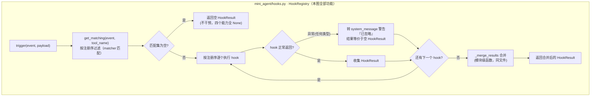
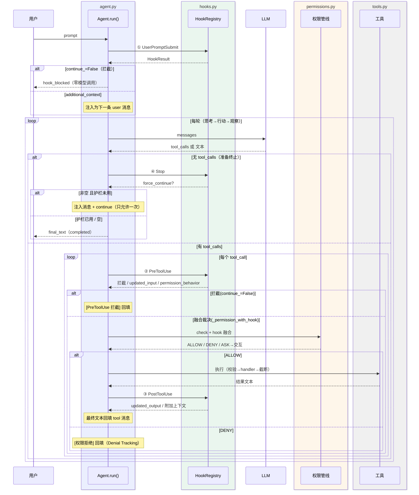

# 迭代 4：Hooks 扩展点 —— 四事件、拦截/改写/注入/续跑与防循环护栏

> 代码：`mini_agent/hooks.py`（注册表与运行器）｜`mini_agent/agent.py`（四个触发点）｜`mini_agent/__main__.py`（内置示例 hooks）
> 测试：`tests/test_hooks.py`（22 个新单测）
> 参考资料：[claude-code-best/claude-code](https://github.com/claude-code-best/claude-code) `docs/extensibility/hooks.mdx`（27 种事件、6 种类型、四种能力、匹配与去重）

## 0. 这一迭代要解决什么问题

迭代 3 的权限系统是**写死在代码里**的：想拦截对 `.env` 的写入？想在大输出时告警？
想在 Agent 宣布完成前强制它再自查一遍？这些都得改 agent.py 源码。

Hook 解决的正是这个问题：**在生命周期固定点上，提供可外部注入的决策函数**。
Claude Code 为此定义了 27 种事件、6 种 hook 类型——教学版取最核心的
**4 事件 × 1 类型（function）**，这是理解 Hook 本质的最小集合：

```
UserPromptSubmit   用户提交任务后、调模型前    → 注入上下文 / 拦截任务
PreToolUse         工具执行前（权限之前）      → 拦截 / 改参数 / 权限决策
PostToolUse        工具执行后（成功路径）      → 改写输出 / 注入上下文 / 告警
Stop               模型终止前                  → 强制续跑（自查）
```

## 1. 环境（无新增依赖）

零新增依赖（fnmatch/dataclasses 标准库）。

## 2. 代码结构拆解

```
mini_agent/
├── hooks.py        # ★ Hook / HookResult / HookRegistry（注册·匹配·触发·合并）
├── agent.py        # 四个触发点 + stop_hook_active 护栏 + hook/权限融合
└── __main__.py     # _builtin_hooks()：guard-env-file + warn-large-output
tests/
└── test_hooks.py   # 22 个新单测
```

### 2.1 HookResult：四种能力一个对象

对应 CC `syncHookResponseSchema` 的「四种 Hook 能力」：

```python
@dataclass
class HookResult:
    permission_behavior: str | None = None   # ① 拦截能力（allow/deny/ask/None）
    updated_input: dict | None = None        # ② 改写能力（改工具参数）
    updated_output: str | None = None        # ② 改写能力（改工具输出）
    additional_context: str | None = None    # ③ 注入能力（进对话）
    system_message: str | None = None        # ③ 注入能力（给用户看，不进对话）
    continue_: bool = True                   # ④ 流程控制（False=拦截）
    stop_reason: str | None = None           # ④ 拦截理由（回填给模型）
    force_continue: str | None = None        # ④ Stop 专用：非空=强制续跑
```

### 2.2 触发与合并语义

`HookRegistry.trigger(event, payload)` 按注册序执行所有匹配 hooks 并**合并**结果：

| 字段 | 合并规则 | 设计理由 |
|------|---------|---------|
| permission_behavior | 取**最严格**（deny > ask > allow） | 多个守卫 hook 各有侧重，安全上取交集 |
| updated_input/output | 最后一个非空（后写覆盖） | 改写是有序管线，类似 middleware |
| additional_context / system_message | **拼接** | 提示信息不互斥 |
| continue_ | 全 True 才 True | 任一 hook 拦截即拦截 |
| stop_reason / force_continue | 第一个非空 | 最早拦截者最优先 |

**hook 异常永不打断主循环**：捕获 → `system_message` 警告 → 继续（CC 同款原则）。

`trigger()` 内部流程（匹配 → 逐个执行 → 异常隔离 → 合并）：



这张图全部位于 `hooks.py` 一个模块内——注册表（`HookRegistry`）、匹配器
（`matches_tool`）与合并器（`_merge_results`）自成一个闭环，外部
（`agent.py`）只拿到最终合并结果。

注意两条「永不崩」路径：匹配集为空返回空结果；单个 hook 异常被隔离成警告、
不影响其余 hooks 执行——hook 是扩展点，扩展点的故障不能变成宿主的故障。

### 2.3 四个触发点的插入位置

完整时序图（Agent 一次 run 中 hooks 与主循环、权限、模型、工具的交互顺序）：



简化版伪代码（上图的骨架）：

```python
run(prompt):
    UserPromptSubmit ← 注入上下文 / 拦截任务（拦截时模型零调用）
    while True:
        调模型
        if 无 tool_calls:
            Stop ← force_continue → 注入消息 + continue（护栏内）
            break
        for each tool_call:
            PreToolUse ← 拦截 / updated_input / permission_behavior
            权限裁决（与 hook 融合，见 2.4）
            执行
            PostToolUse ← updated_output / additional_context
```

**Stop hook 的防循环护栏**（对应 CC `query.ts` 的 `stopHookActive`）：`force_continue`
只允许续跑**一次**。没有护栏，一个「永远不满意」的 Stop hook 会把循环变成永动机
——单测 `test_stop_hook_no_infinite_loop` 用「恰好 2 次模型调用」锁定了这个行为。

### 2.4 hook 与权限的融合规则（本迭代最微妙的部分）

PreToolUse 在权限**之前**触发，但 hook 的 allow **不能凌驾系统边界**（CC 同款）：

```
hook deny  → 直接 DENY（hook 只能加严，不能放宽）
hook ask   → 权限结果 allow 时升为 ASK
hook allow → 权限结果 ask 时免询问；但 deny（黑名单/deny 规则）纹丝不动
hook None  → 原样走权限管线
```

一句话：**hook 是业务语义层，权限是系统边界层——前者只能让后者更严，不能更松**。
三条单测分别验证三个方向（allow 不能翻盘 deny 规则、deny 能压过 allow 规则、
allow 能免交互）。

### 2.5 匹配器（对应 CC matchesPattern）

`matcher="write_file|edit_file"` 管道多值、`"*"` 通配、精确名。UserPromptSubmit/
Stop 事件不按工具过滤（它们与工具无关）。

### 2.6 内置示例 hooks（CLI 自动装配）

1. **guard-env-file**（PreToolUse, matcher=`write_file|edit_file`）：禁止写 `.env`
   ——密钥安全示范，`HookResult.deny()`
2. **warn-large-output**（PostToolUse, matcher=`*`）：结果超 6000 字符时
   `system_message` 告警——迭代 6（压缩）与迭代 15（日志监控）的伏笔

## 3. 运行指令

```bash
cd /Users/nian/CatPaw/agent-mini-harness

# 单测（84 个，无需 key）
.venv/bin/python -m unittest discover -s tests -v

# 真实体感 1：PreToolUse 守卫生效——让模型改 .env（内置 hook 会拦）
.venv/bin/python -m mini_agent "往 .env 里加一行注释"
# 模型会收到 [权限拒绝] PreToolUse hook 拒绝，然后改变策略

# 真实体感 2：大输出告警——glob 扫 .venv 触发 PostToolUse 告警
.venv/bin/python -m mini_agent "用 glob 统计 .venv 下有多少文件"
```

## 4. 测试如何验证（22 个新单测）

| 组 | 验证点 |
|----|--------|
| RegistryTests ×5 | 未知事件拒绝、注销、匹配器（精确/管道/通配/非工具事件）、hook 异常不打断 |
| MergeTests ×5 | 最严格行为胜出、updated_input 后写覆盖、context 拼接、任一 False 拦截、首个理由优先 |
| AgentHookIntegrationTests ×8 | 四事件逐一：上下文注入进请求、任务拦截零模型调用、工具拦截回填、参数改写、输出改写进观察、Stop 续跑一次、护栏防死循环 |
| HookPermissionFusionTests ×3 | hook allow 翻不动 deny 规则、hook deny 压过 allow 规则、hook allow 免交互 |

## 5. 本迭代刻意不做的事

- command 型 hook（shell 子进程 + stdin JSON + 退出码 2 语义）——教学价值在协议而非进程管理，且涉及 shell 安全面
- 27 事件的其余 23 个（SessionStart/SubagentStart/PreCompact…）——对应迭代 12/13/6 时按需引入
- hook 配置文件化（settings.json hooks 段）+ 多来源合并去重——API 直接注册已够教学
- 异步 hook（`{"async":true}` 协议 + AsyncHookRegistry）——迭代 12 后台任务一起做

## 6. 已知局限

- PreToolUse 的 `additional_context` 目前只打印不注入（CC 注入为附件消息；教学版避免消息序协议复杂化）
- matcher 未支持正则模式（CC `"^Bash(git.*)"`）；fnmatch 已覆盖工具名场景
- hook 无超时保护（CC 默认 600s）——教学版 hook 都是进程内函数，异常即返回
