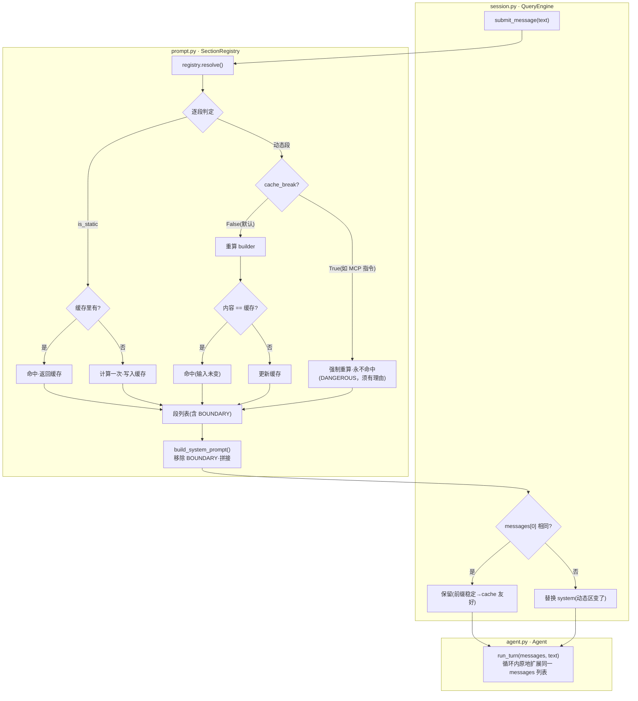
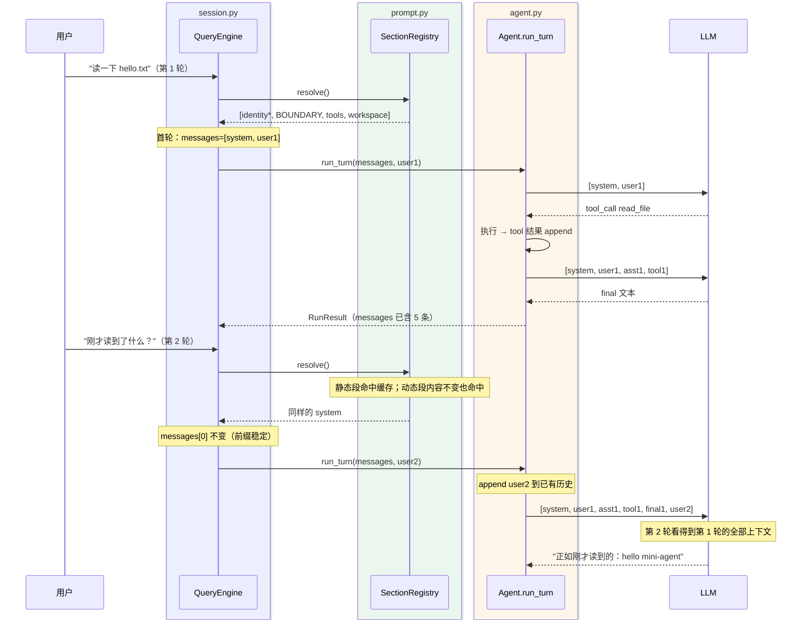

# 迭代 5：维护上下文 —— 多轮会话与 System Prompt 分段组装

> 代码：`mini_agent/prompt.py`（SectionRegistry）｜`mini_agent/session.py`（QueryEngine）｜`mini_agent/agent.py`（run_turn）｜`mini_agent/__main__.py`（REPL）
> 测试：`tests/test_context.py`（18 个新单测）
> 参考资料：[claude-code-best/claude-code](https://github.com/claude-code-best/claude-code) `docs/conversation/multi-turn.mdx`（QueryEngine/onQueryImpl 链路）+ `docs/context/system-prompt.mdx`（三阶段管道/BOUNDARY/Section 缓存）

## 0. 这一迭代要解决什么问题

前四个迭代的 agent 是「金鱼」：每次 `run()` 都从空白对话开始，
上一轮读过的文件、做过的决策、犯过的错误全部失忆。同时 system prompt
是一整段写死的文本——工具增删、目录切换都无法反映。

这一轮补上「维护上下文」：

1. **多轮会话**：QueryEngine 持有唯一对话历史，跨轮复用（`submitMessage` 模式）
2. **System Prompt 分段组装**：静态区 + BOUNDARY + 动态区，每轮 resolve
3. **确定性缓存**：段内容由输入完全决定，输入不变 → 缓存命中（prompt cache 友好）

## 1. 环境（无新增依赖）

零新增依赖（subprocess/platform 标准库）。

## 2. 代码结构拆解

```
mini_agent/
├── prompt.py       # ★ SectionRegistry：分段注册/resolve/缓存 + BOUNDARY
├── session.py      # ★ QueryEngine：messages 跨轮持有 + 每轮组装 system
├── agent.py        # run() 拆出 run_turn(messages, prompt)：增量对话
└── __main__.py     # REPL 模式（无 prompt 参数时进入）
tests/
└── test_context.py # 18 个新单测
```

### 2.1 System Prompt 三阶段管道（CC → 教学版）

| CC 阶段 | 教学版 | 职责 |
|---------|--------|------|
| `getSystemPrompt()` → string[] | `SectionRegistry.resolve()` → list[str] | 组装：静态区 + BOUNDARY + 动态区 |
| `buildEffectiveSystemPrompt()` | （并入 QueryEngine） | 优先级选择（教学版无 override/agent 层） |
| `buildSystemPromptBlocks()` + cache_control | `build_system_prompt()` | 移除 BOUNDARY、拼接为最终文本 |

### 2.2 静态区 / 动态区 / BOUNDARY

```python
registry.register("identity",   lambda: IDENTITY_TEXT, is_static=True)
registry.register("tools",      lambda: _tools_section_text(tools))
registry.register("workspace",  lambda: _workspace_section_text())
```

- **静态区**（identity）：对所有会话相同，只计算一次
- **动态区**（tools/workspace）：内容随环境变化。工具列表以**引用捕获**——
  运行中注册新工具，下一轮 resolve 自动失效缓存并更新
- **BOUNDARY**（`__SYSTEM_PROMPT_DYNAMIC_BOUNDARY__`）：插在静态区与动态区
  之间的分界标记，发送给 API 前移除（模型永远看不到）。它的作用是**为
  prompt cache 划定「不变前缀」**——真实 API 上前缀相同即可命中缓存计费

组装与缓存流程图：



### 2.3 确定性缓存（cacheBreak 语义）

动态段的缓存键不是「是否调用过」而是**内容本身**：每轮重算 builder，
与缓存比对——相同即命中。这意味着：

- 工具列表不变 → tools 段命中 → system prompt 不变 → messages[0] 不变
- `cache_break=True` 的段每轮强制 miss（对应 CC `DANGEROUS_uncachedSystemPromptSection`，
  用于 MCP 指令这类会话中途变化的段，**必须给出破坏缓存的理由**）

为什么静态段「只算一次」而动态段「每轮重算再比对」？静态段内容恒定，
重算无意义；动态段的重算本身就是探测输入是否变化的方式。

### 2.4 QueryEngine：上下文维护的本质

```python
class QueryEngine:
    def submit_message(self, text: str) -> RunResult:
        system = build_system_prompt(self.registry.resolve())
        ...  # 首轮 append / 变化时替换 messages[0]
        result = self.agent.run_turn(self.messages, text)  # ← 原地扩展
        ...  # 跨轮累计 stats
```

**维护上下文的机制本质就一行**：`run_turn(self.messages, text)`——
messages 由 QueryEngine 持有并跨轮传递，第 N 轮请求包含前 N-1 轮的
user/assistant/tool 全部消息。

多轮会话时序图（两轮对话，上下文如何累积）：



#### `engine.messages` 的逐条演变（REPL 实录）

`self.messages` 是什么：一个 `list[dict]`，每条是 OpenAI Chat 协议消息
（`role` / `content`，assistant 可带 `tool_calls`，tool 消息带 `tool_call_id`）。
`QueryEngine` 是唯一持有者，`run_turn` 原地扩展它 —— 所以上面的时序图里
每一箭头都对应列表的一次 append。以 REPL 两轮对话为例（模型读 README.md）：

```text
时刻 A ─ submit_message("读一下 README.md 的第一行")
  [0] system    ← QueryEngine 首轮组装（identity 静态区 + tools + workspace）
  [1] user      ← run_turn append 本轮指令
  → 发给模型（2 条）

时刻 B ─ 模型返回 tool_call（read_file）
  [2] assistant  content=null, tool_calls=[c1: read_file(README.md)]
  → 工具执行后回填观察
  [3] tool       tool_call_id=c1, content="1\t# agent-mini-harness\n2\t…"
  → 再次发给模型（4 条：[0..3]）

时刻 C ─ 模型给出最终文本
  [4] assistant  "README 的第一行是 '# agent-mini-harness'"
  第 1 轮结束：共 5 条

时刻 D ─ submit_message("刚才读到了什么？")
  system 不变（动态段命中缓存 → messages[0] 原样保留）
  [5] user      ← 新指令 append
  → 发给模型（6 条：[0..5] 整包 —— 这就是「携带的上下文」）

时刻 E ─ 模型回答（能看到 [3] 工具结果与 [4] 上轮回答，所以答得出来）
  [6] assistant  "刚才读到的是：# agent-mini-harness"
  会话累计：7 条
```

逐条索引表：

| # | role | 产生时机（模块） | 内容 |
|---|------|-----------------|------|
| 0 | system | `session.py` 首轮组装（`prompt.py` 的段拼接） | identity + 工具清单 + 工作区 |
| 1 | user | `agent.py` run_turn 入口 | "读一下 README.md 的第一行" |
| 2 | assistant | `agent.py` 循环吸收模型响应 | `content=null` + `tool_calls[c1]` |
| 3 | tool | `agent.py` 工具执行后回填 | README 前几行（带行号，受 8k 预算截断） |
| 4 | assistant | 同 2，无 tool_calls → 终止 | 第一轮最终回答 |
| 5 | user | `agent.py` run_turn 入口 | "刚才读到了什么？" |
| 6 | assistant | 同 2 | 第二轮回答 |

两个关键观察：

1. **第 2 轮携带的上下文 = 列表全部 6 条整包重发** —— 这是上下文维护的代价面：
   每轮 input_tokens 随历史线性增长（第 2 轮 > 第 1 轮），也是迭代 6
   （上下文压缩）要治理的对象
2. **列表只增不减**：append 是唯一操作（首轮 system 除外，动态段变化时
   唯一被替换的位置是 `[0]`） —— 删除/压缩发生在迭代 6 之后

### 2.5 run_turn：Agent 的增量改造

```python
def run(self, prompt):                # 单次模式（claude -p）
    messages = [system?] 
    return self.run_turn(messages, prompt)

def run_turn(self, messages, prompt): # 增量模式（QueryEngine 调用）
    state = LoopState(messages=messages)   # 复用同一列表
    state.messages.append({"role": "user", "content": prompt})
    ...  # 循环体不变，所有 append 都进同一历史
```

每轮的 `max_turns` 独立计数（防单轮死循环），但历史无限累积——
这是迭代 6（上下文压缩）要解决的问题。

### 2.6 REPL 与命令

无 prompt 参数进入 REPL：`/clear` 清空会话与 section 缓存、
`/stats` 显示跨轮统计与缓存命中率、`exit` 退出。

## 3. 运行指令

```bash
cd /Users/nian/CatPaw/agent-mini-harness

# 单测（102 个，无需 key）
.venv/bin/python -m unittest discover -s tests -v

# REPL 多轮会话（真实体感：第二轮问"刚才读到了什么"）
.venv/bin/python -m mini_agent
mini-agent> 读一下 README.md 的第一行
...
mini-agent> 刚才读到了什么？
# ← 模型能答出第一行内容：上下文跨轮保留的直接证据
mini-agent> /stats
# [session] turns=2 messages=N tokens(in/out)=... prompt-cache-hit=67%

# 单次模式行为不变（迭代 1-4 的所有用法照旧）
.venv/bin/python -m mini_agent "统计当前目录下有几个 .py 文件"
```

## 4. 测试如何验证（18 个新单测）

| 组 | 验证点 |
|----|--------|
| SectionRegistryTests ×5 | 注册序组装、BOUNDARY 位置、build 移除 BOUNDARY、重名拒绝、全静态无 BOUNDARY |
| DeterministicCacheTests ×5 | 静态段只算一次、动态段内容不变命中、变化失效、cache_break 强制 miss、reset 清缓存 |
| DefaultRegistryTests ×2 | identity/tools/workspace 三段齐全、工具集变化下轮反映 |
| QueryEngineTests ×6 | **上下文跨轮携带**（第二轮请求含第一轮 tool 消息）、usage 跨轮累计、system 变化时替换、/clear 重置、稳态命中率上升、run() 向后兼容 |

开发中顺手修掉测试基建的一个真 bug：`FakeClient` 记录请求时保存的是
messages 列表**引用**，`run_turn` 原地扩展同一列表导致历史记录被污染——
改为调用时刻快照（copy）。这个 bug 之前不暴露，因为迭代 1-4 的每次
run 都用新列表。

## 5. 本迭代刻意不做的事

- 历史无限累积的治理（迭代 6：四层压缩管线）
- JSONL transcript 持久化与 `--resume`（迭代 8）
- CLAUDE.md 类项目记忆文件（迭代 7：记忆系统）
- MCP 指令段（`cache_break` 的真实用例，迭代 20 一起做）

## 6. 已知局限

- 动态段每轮重算 builder（读目录/git 分支），是**探测变化**的必要开销；CC 用更精细的依赖标记避免无谓重算
- 真实 prompt cache 计费需 API 支持 cache_control 块——教学版只保证「前缀稳定性」这个必要条件
- REPL 无 `/compact`、无多会话切换（分别属于迭代 6/8）
