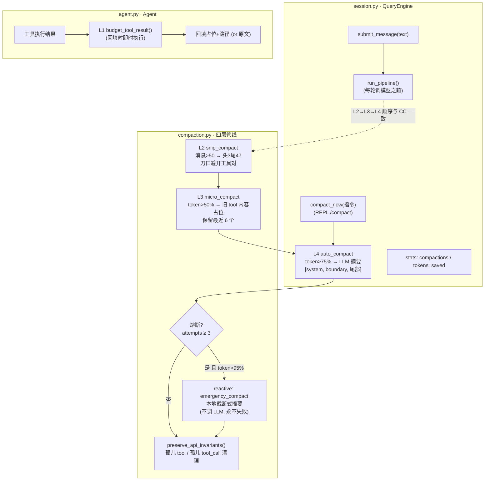

# 迭代 6：上下文压缩 —— 四层管线、配对保护与熔断

> 代码：`mini_agent/compaction.py`（四层管线 + 不变量保护）｜`mini_agent/session.py`（管线调度）｜`mini_agent/agent.py`（budget 即时层）
> 测试：`tests/test_compaction.py`（22 个新单测）
> 参考资料：[claude-code-best/claude-code](https://github.com/claude-code-best/claude-code) `docs/context/compaction.mdx`（三层策略 + applyToolResultBudget + CompactBoundary + 不变量保护）

## 0. 这一迭代要解决什么问题

迭代 5 的 QueryEngine 让历史**只增不减**：第 N 轮请求 = 全部历史整包重发，
`input_tokens` 线性增长。跑 20 轮长会话就会撞上下文窗口上限——
这正是迭代 5 文档里埋下的问题：「删除/压缩发生在迭代 6 之后」。

Claude Code 的答案是五层机制（真实顺序 query.ts:379-468：
budget → snip → micro → collapse → auto）。教学版实现四层 + reactive 应急：

| 层 | 触发条件 | 动作 | 保留什么 |
|----|---------|------|---------|
| L1 budget | 工具结果 > 4000 字符 | 完整内容落盘 `.compact-cache/`，上下文留占位+路径+预览 | 内容不丢（可 read_file 取回） |
| L2 snip | 消息 > 50 条 | 保留头 3 尾 47，中段折叠为一条占位 | 早期探索过程可弃 |
| L3 micro | 估算 token > 50% 窗口 | 旧 tool 消息 content 换占位（消息与配对不动） | 最近 6 个工具结果 |
| L4 auto | 估算 token > 75% 窗口 | LLM 摘要全历史 → `[system, boundary+摘要, 尾部 6 条]` | 摘要 + 最近对话 |
| reactive | 熔断后仍 > 95% | 本地截断式摘要兜底（不调 LLM，永不失败） | 每条消息首 100 字符 |

**设计哲学**（CC 同款）：压缩不是「删一半」，而是**按信息密度分层降级**——
工具结果是可再生的（可重新调用），早期探索是可折叠的，只有摘要与最近
对话是不可再生的核心。

## 1. 环境（无新增依赖）

零新增依赖（hashlib/dataclasses 标准库）。运行产物目录 `.compact-cache/` 已加入 .gitignore。

## 2. 代码结构拆解

```
mini_agent/
├── compaction.py   # ★ 四层管线 + preserve_api_invariants + CompactionConfig/Report
├── session.py      # QueryEngine.submit_message 前调度管线；compact_now(/compact)
└── agent.py        # L1 budget 即时层（工具回填时）
tests/
└── test_compaction.py  # 22 个新单测
```

### 2.1 管线全景图（模块分组）



读图要点：**L1 在 agent.py 即时执行**（工具结果一产生就落盘，等下一轮
submit 才压缩就晚了——这正是 CC「budget 必须在 micro 之前」的原因）；
**L2-L4 在 session.py 每轮 submit 前批量执行**；inv 兜底所有变换。

### 2.2 配对不变量保护（本迭代最关键的正确性机制）

API 硬性要求：`assistant.tool_calls[i].id` 与 `tool.tool_call_id` 一一配对。
任何压缩变换都可能拆散配对（折叠区间切在 assistant 与 tool 之间、
auto 保留尾部恰好切在中间……），所以两条防线：

1. **刀口调整**（`_fold_boundary_adjust`）：snip 折叠区间的起点/终点
   若落在组内 → 前移/后移把整组一起折叠（对应 CC 的 startIndex 前移）
2. **事后清理**（`preserve_api_invariants`）：孤儿 tool 消息删除、
   assistant 中无响应的 tool_call 剔除（剔空且无文本的 assistant 删除）——
   每次变换后统一跑一遍，**宁可保守也不发非法请求**

### 2.3 CompactBoundary（对应 CC createCompactBoundaryMessage）

auto 压缩后的消息结构：

```
[0] system                 ← 原样保留（前缀稳定）
[1] user  "[compact_boundary type=auto pre_tokens=9800 compacted_messages=18]
          以下是对话摘要，请基于它继续工作：……"
[2..] 尾部 6 条            ← 最近对话原样保留
```

`get_messages_after_boundary()` 只取最后一个 boundary 之后的消息
（会话恢复场景避免重复压缩，迭代 8 会用到）。

#### 实战演示：一次 auto 压缩的完整数据变化

以一个 REPL 会话为例（`keep_tail=6`，窗口 10000 token，估算水位 ~8200 已超
75% 阈值）。**压缩前的 messages（13 条）**：

```text
[0]  system     "你是 mini-agent…（identity + 工具清单 + 工作区）"
[1]  user       "读一下 docs/ROADMAP.md 并总结迭代规划"
[2]  assistant  content=null, tool_calls=[c1: read_file(docs/ROADMAP.md)]
[3]  tool       c1 → "[工具结果过大（9000 字符），已完整保存至
                  .compact-cache/read_file-a1b2.txt…]"   ← L1 落盘后的占位
[4]  assistant  "路线图共 8 阶段 23 次迭代，阶段一是基础能力（loop/工具/权限/hooks）…"
[5]  user       "现在统计 mini_agent 下有多少个 .py 文件"
[6]  assistant  content=null, tool_calls=[c2: bash("ls mini_agent/*.py | wc -l")]
[7]  tool       c2 → "exit_code=0 (85 ms)\n7"
[8]  assistant  "共 7 个 .py 文件。"
[9]  user       "把总结写入 summary.md"
[10] assistant  content=null, tool_calls=[c3: write_file(summary.md)]
[11] tool       c3 → "已写入 summary.md（120 字符，3 行）"
[12] assistant  "已写入 summary.md，包含迭代规划与文件统计。"
```

**auto_compact 执行过程**：

1. 计算 `keep_tail=6` → 保留尾部 `[7..12]`，被摘要区间 = `[1..6]`
2. `_render_for_summary` 把 `[1..6]` 渲染成文本交给 LLM，摘要返回：
   「①用户在分析 mini-agent 项目；②读 ROADMAP 得知 8 阶段 23 迭代；
   ③bash 统计 mini_agent/ 共 7 个 .py 文件」
3. 拼装新列表后跑 `preserve_api_invariants`——**注意 [7] 发生了什么**：
   c2 的 assistant（`[6]`）进了摘要区，c2 的 tool 消息（`[7]`）留在保留区，
   刀口恰好把这对拆散 → `[7]` 成了孤儿 → **被不变量保护删除**。
   信息没有丢：c2 的结果「7 个文件」已进摘要第 ③ 条。

**压缩后的 messages（6 条）**：

```text
[0] system     （原样，与压缩前逐字节一致）
[1] user       "[compact_boundary type=auto pre_tokens=8200 compacted_messages=6]
                以下是对话摘要，请基于它继续工作：
                ① 用户在分析 mini-agent 项目
                ② 读 ROADMAP 得知 8 阶段 23 迭代
                ③ bash 统计 mini_agent/ 共 7 个 .py 文件"
[2] user       "把总结写入 summary.md"                      ← 原 [9]
[3] assistant  content=null, tool_calls=[c3: write_file]     ← 原 [10]
[4] tool       c3 → "已写入 summary.md（120 字符，3 行）"     ← 原 [11]
[5] assistant  "已写入 summary.md，包含迭代规划与文件统计。"   ← 原 [12]
```

变化对照：

| 压缩前 | 压缩后 | 说明 |
|--------|--------|------|
| `[0]` system | `[0]` 原样 | 前缀逐字节稳定（prompt cache 友好） |
| `[1]..[6]` 6 条 | `[1]` boundary + 摘要 | LLM 摘要压缩为一条 user 消息 |
| `[7]` tool(c2) | **被删除** | 刀口拆散 c2 配对 → 孤儿被不变量保护清理；结果已进摘要 |
| `[8]` assistant | **进摘要** | 「7 个文件」的信息由摘要第 ③ 条承载 |
| `[9]..[12]` 4 条 | `[2]..[5]` 原样 | 最近一轮完整保留（含 c3 配对） |
| 13 条 / ~8200 tok | 6 条 / ~900 tok | 估算降 ~89% |

这个例子同时演示了三件事：boundary 的结构（`type/pre_tokens/compacted_messages`
三元信息 + 摘要正文）、配对保护的现实触发（刀口拆散 → 孤儿清理，而非调整刀口
——`_fold_boundary_adjust` 只用于 snip 层，auto 层依赖事后清理，这就是
「宁可保守也不发非法请求」）、以及压缩后模型依然能回答「刚才统计了多少文件」
（摘要第 ③ 条承载了原 tool 结果的信息）。

### 2.4 熔断与 reactive（防「压缩风暴」）

auto 压缩调用 LLM 摘要本身也消耗 token。若摘要后仍超阈值 → 再压缩 →
再超 → 无限循环。CC 的对策是 `maxConsecutiveAutoCompactions`（教学版：
`auto_max_attempts=3`）。熔断后若估算仍超 95% 硬限 → `emergency_compact`
本地兜底（每条消息首 100 字符拼接，不调 LLM）——**压缩链路永不失败，
也永无死循环**。

### 2.5 token 估算（±20% 误差的取舍）

`estimate_tokens = 总字符数 // 4`。CC 用精确 encoder；教学版粗估的理由：
触发判定只需要相对水位，±20% 误差换来零依赖。真实场景的「精确计数」
可以用 API 响应的 `usage.prompt_tokens` 校准（迭代 15 观测链路可做）。

## 3. 运行指令

```bash
cd /Users/nian/CatPaw/agent-mini-harness

# 单测（124 个，无需 key）
.venv/bin/python -m unittest discover -s tests -v

# REPL 真实体感：/compact 手动压缩 + /stats 观测压缩效果
.venv/bin/python -m mini_agent
mini-agent> 读一下 docs/ROADMAP.md 并总结
mini-agent> 再看看 mini_agent/agent.py 的循环结构
mini-agent> /stats
# [session] turns=2 messages=8 tokens(in/out)=.../... compactions=0 tokens_saved~0
mini-agent> /compact 聚焦在文件结构上
# （手动压缩完成：消息 N 条……）
mini-agent> /stats
# compactions=1 tokens_saved~xxxx —— 消息变少、摘要已注入 boundary
mini-agent> 我们刚才讨论的循环结构是什么？
# ← 模型基于摘要回答（压缩后的上下文能力验证）

# L1 budget 自动触发：让工具输出超 4000 字符
.venv/bin/python -m mini_agent "用 bash 统计 .venv 里所有 .py 文件的总行数并输出文件清单"
# 工具结果过大 → 自动落盘 .compact-cache/，上下文只留占位+路径
```

## 4. 测试如何验证（22 个新单测）

| 组 | 验证点 |
|----|--------|
| BudgetTests ×3 | 大结果落盘（文件+占位+预览）、小结果不动、占位幂等 |
| InvariantTests ×3 | 孤儿 tool 删除、孤儿 tool_call 剔除、完整配对不动 |
| SnipTests ×3 | 阈值下不动、折叠头尾保留、**刀口不拆工具对** |
| MicroTests ×2 | 旧结果占位最近保留、消息条数不变、阈值下不动 |
| AutoCompactTests ×3 | 摘要结构与 boundary、emergency 永不失败、boundary 切分 |
| PipelineTests ×5 | 仅 snip/micro 不触发 auto、auto 触发且省 token、熔断跳过、熔断+超硬限走 reactive、无摘要器不 auto |
| QueryEngine 集成 ×3 | 长会话自动压缩（boundary 出现）、**agent 回填即时落盘**（bash 大输出）、/compact 聚焦指令随摘要请求下发 |

开发中修掉一个真实兼容性 bug：`estimate_tokens`/`preserve_api_invariants`
假设 tool_calls 是 dict，但 FakeClient 的 SimpleNamespace 响应经
`model_dump` 浅拷贝后仍是属性对象——新增 `_tc_field` 兼容两种形态。
（这个坑迭代 5 的快照修复已埋下伏笔：浅拷贝保留了对象引用。）

## 5. 本迭代刻意不做的事

- collapse 层（相邻同角色消息合并）——收益小，CC 也是后加的
- 会话恢复时利用 boundary 避免重复压缩（迭代 8 一起做）
- 精确 tokenizer（编码依赖，见 2.5 的取舍）
- 断点续传式摘要（CC 的 subAgent 转存方案）

## 6. 已知局限

- 字符/4 估算对中文会低估约 1.5 倍——触发水位偏晚；可通过调小 `context_window_tokens` 配置补偿
- micro 层的「最近 6 个」是固定窗口，CC 按角色与时间衰减加权——教学版从简
- L1 budget 落盘文件无清理策略（长会话累积在 .compact-cache/，CC 用 toolResultCache 管理）
