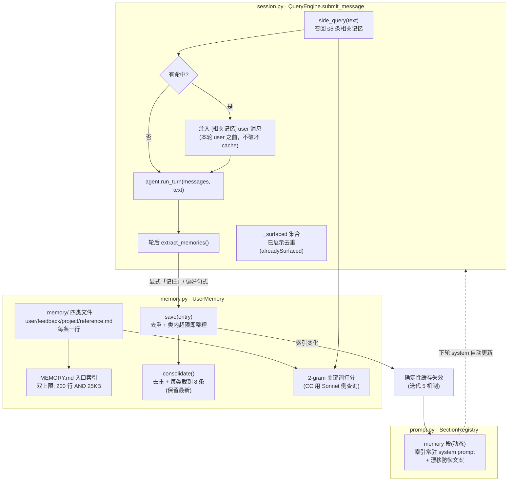
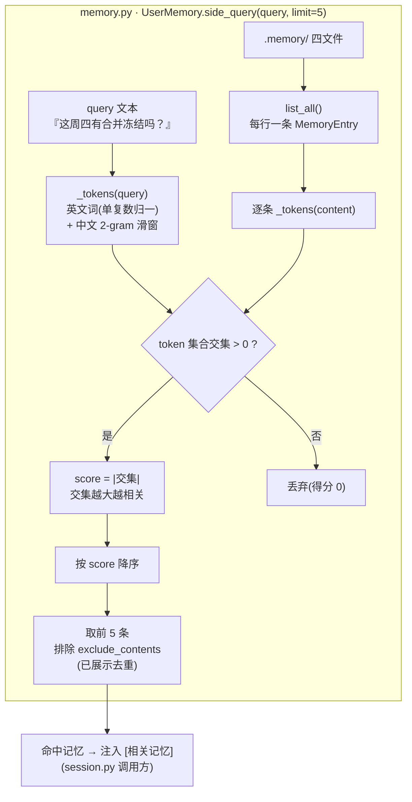

# 迭代 7：记忆系统 —— 纯文件跨会话记忆、四类分类与按需召回

> 代码：`mini_agent/memory.py`（UserMemory + 提取器）｜`mini_agent/prompt.py`（memory 段）｜`mini_agent/session.py`（注入与提取）
> 测试：`tests/test_memory.py`（23 个新单测）
> 参考资料：[claude-code-best/claude-code](https://github.com/claude-code-best/claude-code) `docs/context/project-memory.mdx`（文件架构/四类型/Sonnet 召回/索引上限/漂移防御）

## 0. 这一迭代要解决什么问题

迭代 5/6 解决了「会话内」的上下文维护与压缩，但 agent 依然是「金鱼」的另一种形态：
**每次新会话从零开始**。用户上周说过「不要 mock 数据库」、上个月说过「我是后端开发」
——跨会话全部失忆。

Claude Code 的答案是**纯文件记忆**（没有数据库、没有向量库）：
`.memory/` 目录 + MEMORY.md 入口索引 + 四类型封闭分类 + 按需召回。
本轮完整复刻这套机制。

两层记忆的分工（正名迭代 6 的既有机制）：

| 层 | 生命周期 | 承载者 |
|----|---------|--------|
| Session Memory | 单会话 | 迭代 6 的 auto_compact 摘要（compact_boundary 消息）——本迭代只正名，代码不动 |
| User Memory | 跨会话 | 本轮实现：`.memory/` 文件 |

## 1. 环境（无新增依赖）

零新增依赖（re/datetime 标准库）。`.memory/` 已在 .gitignore（记忆是本机
跨会话状态，不随仓库分发——与 CC 的用户级目录同语义）。

## 2. 代码结构拆解

```
mini_agent/
├── memory.py      # ★ MemoryEntry / UserMemory（存储+索引+召回+整理）/ extract_memories
├── prompt.py      # memory 段注册（索引常驻 system prompt + 漂移防御文案）
├── session.py     # side-query 注入（≤5 条、已展示去重）+ 轮后提取
└── __main__.py    # 装配 UserMemory + REPL /memory 命令
tests/
└── test_memory.py # 23 个新单测
```

### 2.1 记忆生命周期全景（模块分组图）



### 2.2 四类型封闭分类（对应 CC memoryTypes.ts）

| 类型 | 存什么 | 典型触发 |
|------|--------|---------|
| user | 用户角色、偏好、技术背景 | 「我是后端开发」「我写了十年 Java」 |
| feedback | 对 AI 行为的纠正**与确认** | 「别 mock 数据库」「对，就这样」 |
| project | 非代码可推导的项目上下文 | 「合并冻结从周四开始」 |
| reference | 外部系统指针 | 「流水线 bug 在 Linear INGEST」 |

**关键约束（CC 同款）**：只存「无法从当前项目状态推导的信息」——代码架构、
文件路径、git 历史都可实时获取，不配进记忆。feedback 类强调双通道捕获
（失败与成功都要记），否则 AI 会越来越保守。

### 2.3 文件层机制：save 怎么写入、list_all/load_index 怎么读取

**没有数据库，文件就是数据源**。四类文件是 source of truth，
MEMORY.md 是每次读取时重建的派生物。

#### save 的三步（以 `save(MemoryEntry("project", "合并冻结从周四开始"))` 为例）

```python
# ① 查重（读该类已有内容）
existing = {e.content for e in self.list_all() if e.category == "project"}
if entry.content in existing:
    return False                    # 「合并冻结从周四开始」已存在 → 跳过

# ② 追加一行（append-only，永不重写历史行）
with (self.root / "project.md").open("a", encoding="utf-8") as f:
    f.write(f"- {entry.content}\n")

# ③ 类内条数 > 8 → consolidate（裁最旧 + 去重）
```

文件的前后对比（**写入 = 追加一行**）：

```text
# save 前 .memory/project.md          # save 后 .memory/project.md
- 上季度 OKR 是稳定性                 - 上季度 OKR 是稳定性
                                      - 合并冻结从周四开始
```

类别由**文件名**决定（project.md 里的行都是 project 类），内容取行内
`"- "` 前缀之后的文本——这就是文件格式的全部协议。

#### 读取：list_all 与 load_index

`list_all()` 把四文件读成结构化条目（side_query / 查重 / /memory 命令都调它）：

```python
for category in ("user", "feedback", "project", "reference"):   # 文件名 = 类别
    for line in (root / f"{category}.md").read_text().splitlines():
        if line.startswith("- "):                               # 条目行
            entries.append(MemoryEntry(category, line[2:]))     # 去前缀得内容
```

`load_index()` 是**全量重建**而非增量维护：list_all → 按类分组 → 拼出
MEMORY.md → 超限截断 → 写盘。四文件永远可以删掉 MEMORY.md 重建它——
这是「索引是派生物」的检验标准。

### 2.4 实战演示：一条记忆的一生（数据变化）

用户在 REPL 中说「**记住：发布前要跑全量回归测试**」。

**① 轮后提取**（`extract_memories` 命中显式模式 `记住[:：]?\s*(.+)`）：

```text
MemoryEntry(category="project", content="发布前要跑全量回归测试", created_at="2026-10-28T10:30:00")
```

**② 落盘**（`save` 追加到类文件，`.memory/project.md`）：

```markdown
- 发布前要跑全量回归测试
```

**③ 索引重建**（`load_index` 从四文件生成 `.memory/MEMORY.md`）：

```markdown
# Memory index

## project
- 发布前要跑全量回归测试
```

**④ 下轮 system prompt 更新**（memory 段缓存失效——迭代 5 确定性缓存机制的
又一次兑现）：

```text
第二轮 system 的 memory 段（变化前 → 变化后）：
"已知记忆（跨会话，引用前先验证时效…）：
（空——用户尚未沉淀任何跨会话记忆）"
        ↓ 缓存失效（内容比对 miss）
"已知记忆（跨会话，引用记忆前先验证时效：提到文件/函数的记忆是写入时的主张，可能已过时。）：
# Memory index

## project
- 发布前要跑全量回归测试"
```

**⑤ 之后某次会话**，用户问「今天要发布了，有什么要检查的？」——
`side_query` 用 2-gram 打分命中该条（「发布」「回归」均有交集），
**注入到本轮 user 消息之前**（历史前缀不变，不破坏 cache）：

```text
第二次请求的 messages（节选）：
[0] system   "…（含 memory 段：发布前要跑全量回归测试）"
[1] user     "[相关记忆]（按需注入，引用前验证时效）
              - [project] 发布前要跑全量回归测试"
[2] user     "今天要发布了，有什么要检查的？"
```

同一条记忆展示过就进 `_surfaced` 集合（已展示去重）——下一轮同话题不再
重复注入，5 槽预算花在新候选上（对应 CC alreadySurfaced）。

### 2.5 召回器详解：side_query 与 2-gram 打分（数据全过程）

#### 2-gram 是什么

n-gram 是 NLP 的基础概念：**把文本切成 n 个连续单元的滑动窗口片段**。
2-gram（bigram）= 相邻两个单元。为什么中文需要它：英文有空格天然分词
（`pipeline bug` → 两个词），中文没有（「合并冻结」是一整串字符，
切不出「合并」「冻结」这样的词，除非上分词库）。2-gram 是**零依赖的
最小可行近似**：滑动窗口逐字符取两字——「合并冻结」→ 合并、并冻、冻结。

`_tokens()` 的两条规则：

```python
# 英文：正则取词（≥2 字符），单复数归一（"bugs" → "bug"）
re.findall(r"[a-zA-Z_][a-zA-Z0-9_]*", text.lower())
# 中文：滑动窗口取 2 字符（仅含汉字的片段才计入）
text[i:i+2]  # "合并冻结从周四开始" → 合并/并冻/冻结/结从/从周/周四/四开/开始
```

#### side_query 打分管道（模块分组图）



#### 一次真实打分的全过程数据

记忆库（四文件内容）与 query = **「这周四有合并冻结吗？」**：

```text
_tokens(query) = {这周, 周四, 四有, 有合, 合并, 并冻, 冻结, 结吗}
                 （8 个中文 2-gram）
```

| 记忆（类别:内容） | _tokens(content) | 与 query 的交集 | score |
|------------------|------------------|------------------|-------|
| project: 合并冻结从周四开始 | 合并,并冻,冻结,结从,从周,周四,四开,开始 | **合并,并冻,冻结,周四** | **4** |
| user: 用户偏好用 pytest 写测试 | 用户,户偏,偏好,pytest,写测,测试 | ∅ | 0 |
| feedback: 不要 mock 数据库 | 不要,mock,数据,据库 | ∅ | 0 |
| reference: 流水线 bug 记录在 Linear | 流水,水线,bug,记录,录在,linear,ingest | ∅ | 0 |

→ 只有第一条 score>0，命中并注入。

英文侧同理（query = "where are pipeline bugs tracked"）：

```text
_tokens(query)   = {where, are, pipeline, bug, tracked}   ← "bugs"归一成"bug"
_tokens(reference 记忆) = {流水, 水线, bug, 记录, 录在, linear, ingest}
交集 = {bug} → score = 1 → 命中
```

#### 已知局限（关键词召回的固有天花板）

- **同义/跨语言无字面交集**：query "pipeline" 对记忆「流水线」交分为 0
  ——pipeline 与 流水/水线 无任何共同 token。CC 用 Sonnet 语义召回
  正是为解决这类；教学版接受它，代价是召回偏保守（宁漏勿错）
- **词形变化仅覆盖单复数**：running/ran 这类变形无能为力
- **交集大 ≠ 更相关**的边角：「测试」会在大量记忆里命中——2-gram 打分
  是相关性粗筛，不是排序语义（CC 的 LLM 召回同样只做筛不做精排）

### 2.6 漂移防御（对应 TRUSTING_RECALL_SECTION）

记忆可能过期。memory 段固定携带：「引用记忆前先验证时效：提到文件/函数的
记忆是写入时的主张，可能已过时」。CC 的 A/B 测试结论（3/3 vs 0/3）：
**行动导向的标题**（"Before recommending from memory"）好于抽象描述
（"Trusting what you recall"）——教学版直接采用胜出文案的语义。

### 2.7 整理（consolidate）

`save` 后类内条数超 8 → 整理：去重（同内容）+ 每类裁到 8 条（保留最新）。
开发中修掉一个触发条件 bug：最初按「总条数 ≥24」触发——裁剪一次后总数
回落到阈值以下，后续保存**永远不会再次触发**，限制失效。改为「类内超限
即触发」后语义正确（单测锁定：连续保存 30 条，最终恰 8 条且保留最新）。

## 3. 运行指令

```bash
cd /Users/nian/CatPaw/agent-mini-harness

# 单测（147 个，无需 key）
.venv/bin/python -m unittest discover -s tests -v

# REPL 真实体感：记忆的完整一生
.venv/bin/python -m mini_agent
mini-agent> 记住：这个项目的发布节奏是每周四
# （轮后提取保存 → 下轮 system 已含该记忆）
mini-agent> 这周什么时候发布？
# （side-query 命中 → 注入 [相关记忆] → 模型基于记忆回答）
mini-agent> /memory
#   [project] 这个项目的发布节奏是每周四
mini-agent> exit

# 重启会话（跨会话验证——记忆的生命周期是磁盘不是会话）
.venv/bin/python -m mini_agent
mini-agent> 发布节奏是什么？
# （新会话第一轮就能命中记忆并回答——这是「跨会话」的直接证据）

ls .memory/
# MEMORY.md  project.md  …（纯文件，可 grep 可手编）
```

## 4. 测试如何验证（23 个新单测）

| 组 | 验证点 |
|----|--------|
| StorageTests ×5 | 非法类别拒绝、保存/读取、重复跳过、索引反映、空占位 |
| SideQueryTests ×5 | 相关性排序、英中混合、≤5 上限、无命中空、已展示排除 |
| ExtractTests ×6 | 显式中/英、偏好句式、纠正句式、无信号、显式优先 |
| ConsolidateTests ×2 | 类内超限触发裁剪（保留最新）、手工脏数据去重 |
| IntegrationTests ×5 | **memory 段缓存失效**、**side-query 注入进请求**（含去重计数）、**「记住」→ 磁盘 → 下轮 system**、/clear 不清记忆、memory=None 向后兼容 |

## 5. 本迭代刻意不做的事

- Sonnet 侧查询召回（LLM 语义筛选——留待需要语义跨语言时引入，2.4 有取舍说明）
- 每条记忆独立文件 + frontmatter（name/description/type——CC 粒度，教学版行式条目够用）
- KAIROS 每日日志模式 + /dream 夜间蒸馏
- 忽略记忆的严格语义（"proceed as if MEMORY.md were empty"）
- 记忆编辑工具（CC 的 memory 工具集，让模型主动读写记忆）

## 6. 已知局限

- 2-gram 召回无法跨语言/同义匹配（见 2.4）；查询词过短（<2 字符）时无法命中
- 提取器是规则式（正则句式），CC 由模型的记忆保存指令判断——规则会漏掉隐式偏好（如用户连续三轮纠正同一行为）
- 索引重建在每次 load_index 时全量重写（记忆量小无感；CC 用缓存 + mtime 检查）
