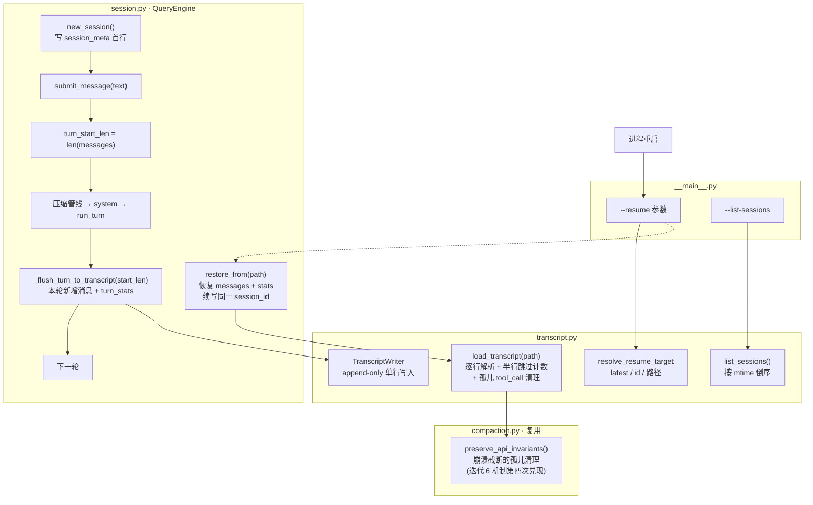

# 迭代 8：保存状态 —— JSONL Transcript 与会话恢复

> 代码：`mini_agent/transcript.py`（写入/恢复/崩溃容错）｜`mini_agent/session.py`（自动持久化 + restore_from）
> 测试：`tests/test_transcript.py`（11 个新单测）
> 参考资料：[claude-code-best/claude-code](https://github.com/claude-code-best/claude-code) `docs/conversation/multi-turn.mdx` 的 sessionStorage 章节（JSONL 追加写入 / --resume 链路 / 50MB 上限）

## 0. 这一迭代要解决什么问题

迭代 5-7 让上下文与记忆跨轮、跨会话可用，但 agent 本身仍是「关机即失忆」：
Ctrl+C 或崩溃后，`engine.messages` 灰飞烟灭——哪怕上一秒刚读完 20 个文件。

「保存状态」= **把会话事件流持久化到磁盘**。Claude Code 的答案是 JSONL
transcript：`~/.claude/projects/<dir>/<session-uuid>.jsonl`，一行一条事件，
append-only。本轮完整复刻（教学版存 `sessions/<id>.jsonl`，已 gitignore）。

## 1. 环境（无新增依赖）

零新增依赖（json/uuid/datetime 标准库）。

## 2. 代码结构拆解

```
mini_agent/
├── transcript.py   # ★ TranscriptWriter（append-only 落盘）/ load_transcript（恢复+容错）
│                   #   / list_sessions / resolve_resume_target（--resume 三形态）
└── session.py      # QueryEngine：每轮增量落盘 _flush_turn_to_transcript + restore_from
tests/
└── test_transcript.py  # 11 个新单测
```

### 2.1 为什么是 JSONL 而不是「整个 JSON 文件」

| 维度 | JSONL（一行一条） | 整体 JSON 文件 |
|------|------------------|---------------|
| 写入 | **追加一行**（O(1)） | 读全文→改→重写全文（O(n)） |
| 崩溃 | 最多损毁**最后一行**，前面的完整 | 可能整个文件损坏 |
| 读取 | 流式逐行，可只读尾部 | 必须整体解析 |
| 定位 | `tail -1` 即最新状态 | 无此便利 |

这就是数据库 WAL（write-ahead log）与 append-only 日志的同款设计。
CC 在此之上加了异步写队列 + 定时刷盘（多并发源不互相覆盖）——教学版
REPL 单线程同步写即可，无并发覆盖风险。

### 2.2 会话生命周期（模块分组图）



### 2.3 记录格式与文件内容（数据变化实例）

一次两轮 REPL 会话（第一轮读 hello.txt，第二轮总结）落盘后的
`sessions/a1b2c3d4e5f6.jsonl` **全文**——每行一条 JSON：

```json
{"type": "session_meta", "session_id": "a1b2c3d4e5f6", "created_at": "2026-10-28T11:00:00", "cwd": "/Users/nian/CatPaw/agent-mini-harness", "model": "deepseek-chat"}
{"type": "message", "role": "system", "content": "你是 mini-agent…（含工具清单/工作区/记忆索引）"}
{"type": "message", "role": "user", "content": "读 hello.txt"}
{"type": "message", "role": "assistant", "content": null, "tool_calls": [{"id": "c1", "type": "function", "function": {"name": "read_file", "arguments": "{\"path\": \"hello.txt\"}"}}]}
{"type": "message", "role": "tool", "tool_call_id": "c1", "name": "read_file", "content": "1\thello mini-agent"}
{"type": "message", "role": "assistant", "content": "文件内容是 hello mini-agent"}
{"type": "turn_stats", "turn": 1, "input_tokens": 812, "output_tokens": 47}
{"type": "message", "role": "user", "content": "总结"}
{"type": "message", "role": "assistant", "content": "读到了 hello mini-agent"}
{"type": "turn_stats", "turn": 2, "input_tokens": 1310, "output_tokens": 35}
```

三种记录类型的分工：

| type | 内容 | 作用 |
|------|------|------|
| `session_meta` | id/创建时间/cwd/model | 文件首行；list_sessions 与 resume 定位 |
| `message` | 一条对话消息全部字段 | 恢复 messages 的唯一来源 |
| `turn_stats` | turn 序号 + token 用量 | 恢复累计统计（CC restoreCostStateForSession） |

**增量落盘的关键**：`turn_start_len` 在压缩管线与 system 组装**之后**记录——
本轮只写「system 替换、user、assistant、tool、stats」这些**新**事件，
上一轮已写过的永不重写（对应 CC recordTranscript 的事件流水语义）。

### 2.4 恢复（--resume）的数据变化

进程重启后 `python -m mini_agent --resume latest`：

```text
load_transcript("sessions/a1b2c3d4e5f6.jsonl")
  逐行解析 10 行 → meta(1) + messages(8) + turn_stats(2)

restored.messages（重建的内存状态）:
  [0] system  （与落盘时逐字节一致）
  [1..7] 第一轮与第二轮的全部消息
restored.stats: turns=2, input_tokens=2122, output_tokens=82

engine2.restore_from(path) 之后:
  engine2.messages        = 8 条完整上下文 ← 模型看得到两轮历史
  engine2.session_meta    = 原 meta（续写同一文件，不另开新档）
  engine2.stats           = turns=2 …（累计恢复）, resumed=True
  engine2._auto_attempts  = 0（熔断计数不跨进程）

用户继续说「继续」→ 新事件追加到同一文件:
  {"type": "message", "role": "user", "content": "继续"}
  {"type": "message", "role": "assistant", "content": "…"}
  {"type": "turn_stats", "turn": 3, …}     ← 文件里 turn=3 出现，续写成功
```

### 2.5 崩溃容错（append-only 的红利）

先把「崩溃」这个调具体化——进程在什么时刻被杀，会丢什么、不丢什么。

#### 崩损面分析：一条消息的一生 vs 落盘时机

一轮 submit 的内部顺序（谁在什么时候落盘）：

```text
submit_message("读文件")
 ① run_pipeline 压缩          （纯内存，不落盘）
  ② boundary 落盘             （←仅当本轮触发 auto/reactive）
  ③ system 组装/替换           （内存）
  ④ turn_start_len = len(messages)   （内存记账）
  ⑤ run_turn 循环：
     调模型 → assistant append（内存）
     工具执行 → tool append（内存，含 budget 落盘）
     …循环…
  ⑥ 本轮全部新消息 + turn_stats 一次性落盘（同步写盘）
```

关键点：**⑥ 是同步的**——一轮结束后、返回用户前，write() 已经完成。
所以崩溃窗口 = 正在执行 ⑤ 的时刻。对每个时刻做崩溃推演（数据变化）：

| 崩溃时刻 | 内存 messages | 磁盘 transcript | 恢复结果 | 丢失量 |
|---------|---------------|-----------------|---------|--------|
| ①② 后（压缩完，本轮未开始） | 已压缩（含 boundary） | boundary 已落盘 | 压缩结果完整保留，**不重新摘要** | 0 |
| ⑤ 中：assistant(tool_calls) 刚写内存，tool 未落盘 | 含孤儿 tool_call | 无此轮记录 | 半行都没有——**整轮丢弃** | ≤1 轮 |
| ⑤ 中：3 条已入内存但未 flush | 3 条在内存 | 上轮为止完整 | 整轮丢弃 | ≤1 轮 |
| ⑥ 写盘中途（写完第 2 行，第 3 行只写一半） | 3 条 | 2 行完整 + 半行 | 半行解析失败 → skipped_lines 计数，**前两行保住** | 半条消息 |
| ⑥ 完成后 | =磁盘 | 完整 | 完整恢复 | 0 |

两个结论：

1. **崩溃最多丢当前轮**（粒度是「轮」不是「会话」）——这是把 flush 放在轮末而非会话末的意义：轮内的多步工具调用只需最后一次写盘
2. **半行损坏的传播边界**：单次 write 不是原子的——磁盘上可能出现写了一半的行。防线是逐行独立解析：`json.loads` 失败的行跳过并计入 `skipped_lines`，把风险收敛为「丢半行」而非「丢全文件」（恢复时向用户报告「跳过 N 行损坏记录」）

#### 孤儿 tool_call：写入中断的第二形态

崩溃还有另一种切入：不是半行，而是**完整行但不完整对**——进程死在
assistant(tool_calls) 落盘之后、对应 tool 消息落盘之前（两者都在 ⑥ 一次性写，
但崩溃可以发生在两行 write 之间）。恢复时：

```text
transcript 尾部：  …assistant tool_calls=[c1, c2]  ← 已写入
                                     c1 的 tool 消息    ← 已写入
                                     c2 的 tool 消息    ← 未写入（崩溃）
恢复侧：load_transcript → preserve_api_invariants 清理 c2
         （宁删孤儿不发非法请求——迭代 6 配对保护的第四次复用）
```

### 2.6 落盘时机全景：什么写、什么不写、为什么

这是最容易误解的部分——逐项列清单（含本轮修正的两个 bug）：

| 事件 | 落盘？ | 时机与理由 |
|------|-------|-----------|
| session_meta | ✅ 首行 | new_session 时（初始化或 /clear 开新档） |
| 本轮新消息（user/assistant/tool） | ✅ | ⑥ 轮末同步 flush（turn_start_len 切片） |
| turn_stats | ✅ | ⑥ 同上，一条记录 |
| **压缩 boundary** | ✅ **（本轮修正）** | ② 触发时立即写。曾遗漏：turn_start_len 在压缩之后记录，boundary 位于其前，轮末 flush 永远写不到它 → 恢复时拿不到摘要，每个新进程重新烧一次 LLM。修复后 boundary 是事件，恢复可切片消费 |
| **压缩前的旧消息** | ❌ 不删不补 | transcript 是事实流水（fact stream）：压缩只改内存，旧消息永远留在文件里。想「看到压缩后状态」靠恢复切片（见 2.7） |
| snip/micro 占位 | ❌ | 无 LLM 成本；恢复后重放同样的确定性变换即可（重跑 run_pipeline 结果相同） |
| system 替换 | ⭕ 隐式 | 不单独记事件——但每次都作为 message 落盘新值吗？否：system 位于 turn_start_len 之前，常规 flush 不写。**恢复时重新组装**（registry.resolve 确定性重建，与迭代 5 缓存同源） |
| 工具大结果全文 | ✅ 另档 | budget 层落 `.compact-cache/<tool>-<sha1>.txt`（内容寻址；transcript 里只有占位） |
| 记忆保存 | ✅ 另档 | `.memory/` 四文件（迭代 7；transcript 只记对话） |

**增量语义的核心**：`turn_start_len` 必须在压缩与 system 之后记录——
否则会把上一轮已写过的事件重复写入（transcript 变成无限膨胀的流水）。

另一个本轮修正的 bug：`/clear` 现在**开新档**（新 session 文件）——
否则清空后继续写旧文件，将来 --resume 旧档会重放已清空的历史。

### 2.7 恢复与压缩的交互（boundary 切片）

对应 CC getMessagesAfterBoundary。文件里压缩前的旧消息**永远存在**——
恢复时如何得到「压缩后状态」？从最后一个 boundary（含）开始切：

```text
transcript 文件（事实流水）：
  [meta, m1, m2, …, m18,                      ← 压缩前的历史（永远留在文件里）
   boundary(auto), m19, m20]                  ← 压缩事件 + 之后的新消息

restore_from 切片：
  找最后一个 boundary → msgs = msgs[last_boundary:]

恢复后的 engine.messages：
  [boundary(auto, 摘要+尾部), m19, m20]        ← 就是压缩后的工作集
  （system 缺失 → 下一轮 submit 时 insert(0) 重建——
    这也修复了第三个 bug：曾用 messages[0]="system" 直接覆写，
    boundary 会被当 system 毁掉）
```

三个效果的实测验证（单测 test_boundary_persisted_and_restore_slices）：

1. 恢复后的 messages **以 boundary 开头**——不是全历史重放
2. 下一轮水位已低 → **不重新触发 auto**（summarizer 被调用即断言失败）
3. LLM 摘要费用只花一次——换进程不重复花钱

熔断计数跨进程归零是安全的：若恢复后水位仍高（尾部保留太多），下轮
run_pipeline 自然再触发——新的压缩事件又落盘，旧的 boundary 失效。

## 3. 运行指令

```bash
cd /Users/nian/CatPaw/agent-mini-harness

# 单测（158 个，无需 key）
.venv/bin/python -m unittest discover -s tests -v

# 完整体感：两进程接力
.venv/bin/python -m mini_agent
mini-agent> 读一下 docs/ROADMAP.md 的迭代规划
mini-agent> exit
ls sessions/                    # ← 会话已自动落盘

.venv/bin/python -m mini_agent --resume latest
# ↻ 已恢复会话 a1b2c3d4e5f6（2026-10-28T11:00:00，1 轮，N 条消息）
mini-agent> 接着刚才的，下一步是什么迭代？
# ← 模型基于恢复的上下文回答（跨进程记忆的直接证据）

.venv/bin/python -m mini_agent --list-sessions   # 查看全部会话
head -1 sessions/<id>.jsonl                       # 人读文件：首行即元信息
```

## 4. 测试如何验证（11 个新单测）

| 组 | 验证点 |
|----|--------|
| WriterTests ×3 | meta 首行、JSONL 行格式（中文不转义）、目录删除后 mkdir 重试 |
| RestoreTests ×5 | 两轮完整往返（messages+stats）、**半行崩溃跳过计数**、**孤儿 tool_call 清理**、缺 meta 拒绝、list 倒序 |
| EngineIntegrationTests ×6 | **跨进程接力**（新 engine 恢复后续写同一文件、turn=3 落盘）、**boundary 落盘 + 恢复切片 + 不重新摘要**（summarizer 被调即断言失败）、**恢复后 boundary 开头时 system insert 不覆写**、**/clear 开新档**（新对话不入旧档）、transcript=None 向后兼容、resume 三形态解析 |

开发中修掉两个集成 bug（都有普适教学价值，写进 2.5）：
`return result` 误置于 stats 累计之前（死代码）；`SimpleNamespace` 对象
无法 JSON 序列化——`_plain_message` 落盘前规约（与迭代 6 的 `_tc_field`
同源：假客户端的浅拷贝残留是反复出现的坑）。

用户提问触发深挖又修三个真 bug（写进 2.6/2.7，均有单测锁定）：
boundary 不落盘（恢复即重复烧 LLM 摘要）、system 覆写 boundary
（恢复后丢失摘要）、/clear 不开新档（resume 重放已清空历史）。
这是「文档讲不清楚 = 实现有缝隙」的又一次印证。

## 5. 本迭代刻意不做的事

- 异步写队列 + 定时刷盘（CC 为多并发源设计；教学版单线程同步写即可）
- 远程持久化（CCR v2 internalEventWriter / Ingress 上传）
- --rewind-files（把工作区文件回滚到某消息时刻的快照）
- 多项目目录隔离（CC 按 sanitized-cwd 分目录；教学版单目录）
- 密钥/脱敏处理（内部 transcript 明文——.gitignore 已隔离）

## 6. 已知局限

- 每轮同步写盘有 IO 开销（REPL 场景无感；高频 agent 服务需批量刷盘）
- turn_stats 是累计值快照而非增量（恢复取 max(turn) 与求和的混合语义，够用但不严格）
- 恢复不还原权限管理器状态（会话级 always 规则/拒绝计数随进程消失——安全侧的可接受损失）
